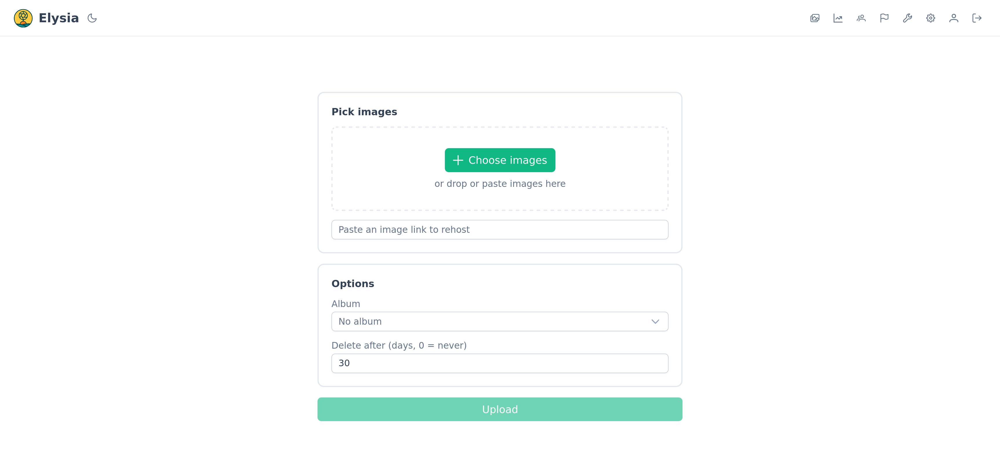
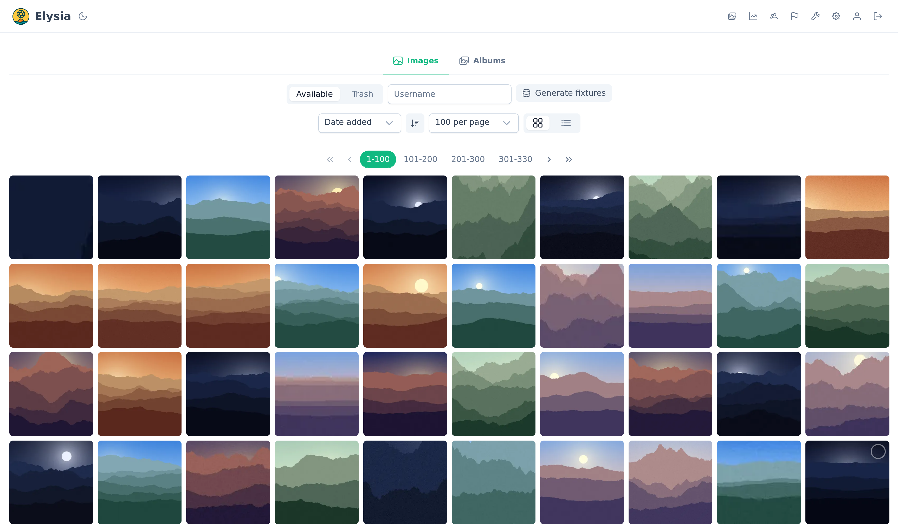
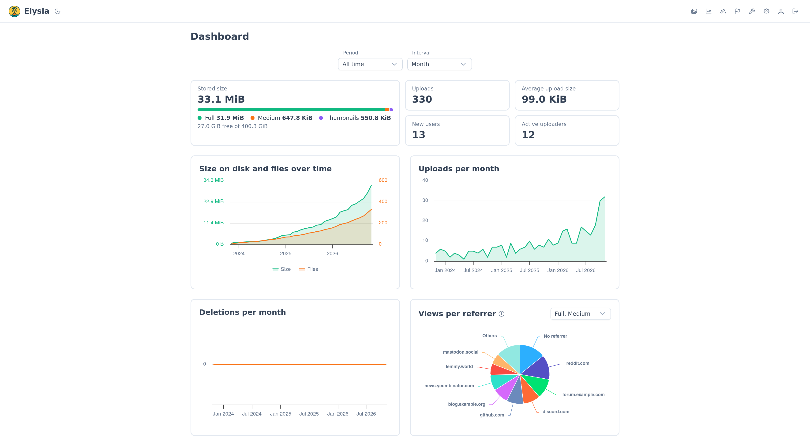
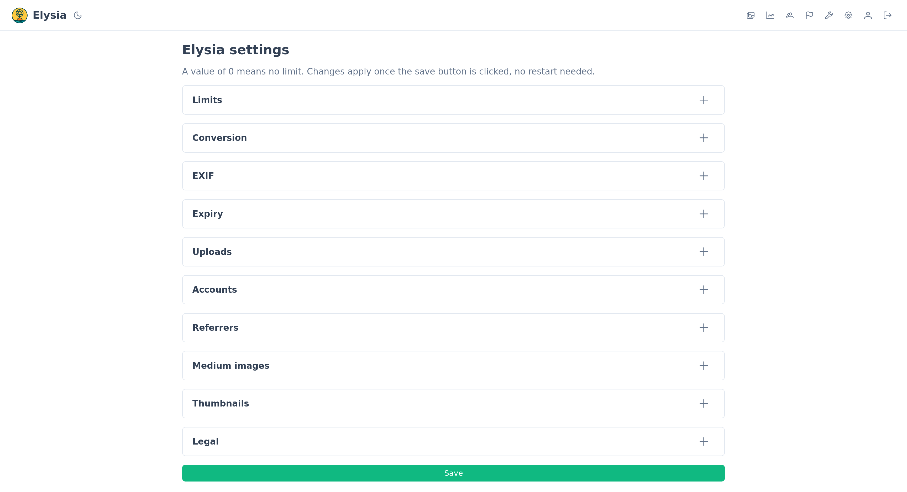

<h1 align="center">
  <br/>
  Elysia
</h1>

<p align="center"><b>Self-hosted image host, built to sit next to your website.</b></p>

<p align="center">
  <a href="https://github.com/Arcadia-Solutions/Elysia/actions/workflows/backend.yml"></a>
  <a href="https://github.com/Arcadia-Solutions/Elysia/actions/workflows/frontend.yml"></a>
  <a href="https://github.com/Arcadia-Solutions/Elysia/actions/workflows/e2e.yml"></a>
  <a href="https://github.com/Arcadia-Solutions/Elysia/actions/workflows/backend.yml"></a>
  <a href="https://arcadia-solutions.github.io/Elysia/"></a>
</p>

<p align="center">
  <a href="https://discord.gg/amYWVk7pS3"></a>
  <a href="https://matrix.to/#/%23Arcadia-Solutions%3Amatrix.org?via=matrix.org"></a>
</p>

## Screenshots






Elysia lets users upload images, re-encodes and de-duplicates them, and serves them under stable links. It is made to pair with [Arcadia](https://github.com/Arcadia-Solutions/Arcadia), but works with any website.

## Features

- **Uploads** from a file, the clipboard or a URL
- **Re-encoding** to WebP, JPEG XL, AVIF, PNG or JPEG (or lossless), metadata stripping, medium and thumbnail previews
- **Integration** with another site: OpenID Connect SSO, uploads on behalf of users, API keys, hotlink protection by referrer
- **Moderation**: reports, trash, expiry, user management
- **Maintenance tools**: similar image detection (perceptual hash), unreferenced image cleanup (in your website's db)
- **Chevereto importer** with link rewriting, dry run and resume
- **Operations**: admin dashboard, rate limiting, disk space guard, outbound proxy, OpenTelemetry traces/metrics/logs
- **Customizable**: logo, favicon, custom CSS/JS, terms of service and privacy policy pages
- **OpenAPI** schema with Swagger UI

## Stack

| Part | Tech |
| --- | --- |
| Backend | Rust, actix-web, PostgreSQL (sqlx) |
| Frontend | Vue 3, TypeScript, PrimeVue |

## Quick start

```sh
cp config.example.yml config.yml   # set auth.jwt_secret at least
docker compose --profile app up -d
```

The web UI is then on <http://localhost:5174>. See [the docs](https://arcadia-solutions.github.io/Elysia/) for installation, administration, integration, backups and development.
